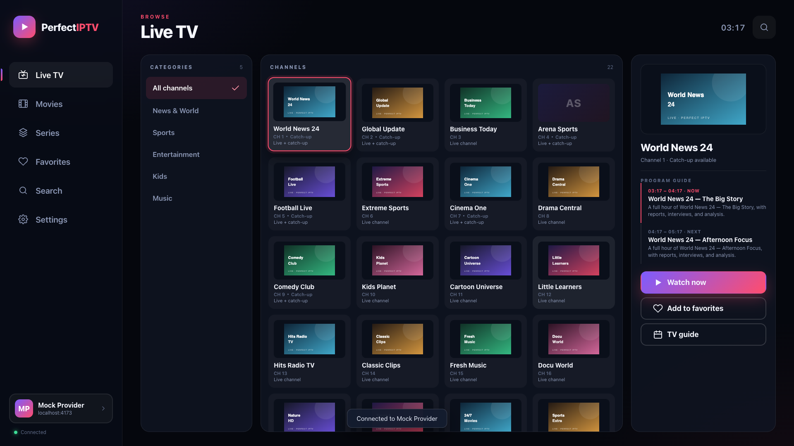
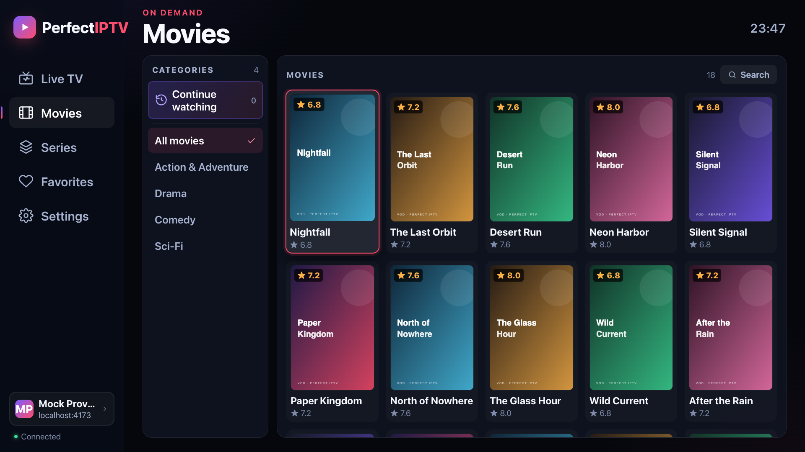
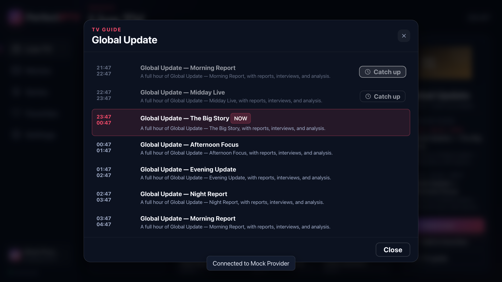

# Perfect IPTV for Samsung TVs

A Tizen web app for your **Xtream Codes** provider: live TV, movies, series,
EPG and a remote-first player, running entirely on a Samsung TV.



## What it does

- **Live TV** with categories, channel logos, lazy-loaded channel grids and a
  focused-channel preview
- **EPG** with now/next in the preview and a full guide per channel, when the
  provider publishes guide data
- **Movies and series** with categories, posters, plots, cast, seasons and
  episodes
- **Recently added** in Movies and Series, derived from the provider’s catalog
  timestamps (the 200 newest movies or series are shown)
- **Sorting** in Live TV, Movies and Series: default provider order, name A–Z,
  name Z–A, or recently added
- **Search inside each section** — Live TV, Movies and Series each have their
  own search with results that update as you type, so results never mix
  channels with movies or series
- **Continue watching** in every section, with recent live channels and resume
  positions for movies and episodes
- **Favorites** for channels, movies and series
- **Adjustable text size** (Standard, Large, Extra large; Standard by default)
  for different TVs and viewing distances
- **Saved accounts**, with automatic reconnect on the next launch
- **AVPlay hardware playback** on Samsung TVs, with an HTML5/hls.js fallback
- **Works without CORS** on most TVs through the Tizen native downloader
- **10-foot UI** with full D-pad, Back, OK, Info, channel and media keys
- **Live channel zapping** with Channel Up/Down while a stream is playing






## Download

Grab the latest `PerfectIPTV-X.X.X.wgt` from
[Releases](https://github.com/iTzFaisal/perfect-iptv/releases/latest), then
follow [Install on the TV](#install-on-the-tv).

The package is **unsigned**: [Tizen Homebrew](https://github.com/SushyDev/tizen-homebrew)
re-signs it during install, or you can sign it yourself with Tizen Studio.
To build from source, see [Build](#build).

## Requirements

- A Samsung Smart TV running **Tizen 6.0 or newer** (roughly 2021 and later;
  the app is designed for 2024+ TVs)
- An active Xtream Codes login from your IPTV provider
- A computer on the same network for the one-time install
- Node.js 20+ on that computer (only when building from source)
- A Samsung developer account and/or
  [Tizen Homebrew](https://github.com/SushyDev/tizen-homebrew) for sideloading
- A free Cloudflare account (only if you need the optional CORS proxy)

The app has been tested in Chromium at 1920×1080 and against a live Xtream
panel with 13,000+ live channels. It has not been tested on every Samsung
firmware. AVPlay and the Tizen native downloader are the parts most likely to
need a small adjustment on an unusual model.

## Why there is a native downloader (and a proxy)

Xtream panels often do **not** send `Access-Control-Allow-Origin`. A packaged
Tizen app runs from a local origin, so the TV’s webview blocks a normal
`fetch()` to the provider even when the TV can reach the server.

The app handles this in two ways:

1. **Direct `fetch`** when the panel sends CORS headers.
2. **Tizen native downloader** when it does not. The app downloads the
   `player_api.php` JSON with `tizen.download` and reads it from private
   storage with `tizen.filesystem`. Native downloads are not subject to
   browser CORS.

The manifest requests the `download`, `filesystem.read`, and
`filesystem.write` privileges for that fallback. It applies to **API JSON
only**; video goes straight to AVPlay, and images load directly, so neither
needs CORS.

If your TV does not expose the Download API and your provider does not send CORS
headers, deploy the optional proxy:

- `proxy/worker.mjs` — a Cloudflare Worker
- `proxy/server.js` — a small Node proxy for your LAN

Set the proxy URL in **Advanced options** on the login screen. The Worker adds
the missing CORS header and does not store anything. Your provider credentials
pass through it only if you configure it, so self-host it.

Desktop browser previews cannot use the TV downloader. Use the included mock
provider or a proxy when testing a real panel in Chrome.

## Build

```sh
npm install
npm run package
```

This produces `dist/PerfectIPTV-1.1.1.wgt`.

To sign it with a Tizen Studio certificate profile instead:

```sh
TIZEN_PROFILE=YOUR_PROFILE npm run package
```

That produces `dist/PerfectIPTV-1.1.1-signed.wgt`. You can also re-sign the
unsigned file manually; see Option B below.

### Optional proxy deployment

The proxy is only needed when the TV cannot use the native downloader and the
provider lacks CORS headers.

Cloudflare Worker:

```sh
npm create cloudflare@latest -- perfect-iptv-proxy
# copy proxy/worker.mjs to src/index.js
npx wrangler deploy
```

Optionally set `ALLOWED_HOSTS` to your provider’s hostname. Put the deployed
`https://…workers.dev` URL in the app’s **Advanced options → CORS proxy URL**.

Local Node proxy:

```sh
node proxy/server.js
# http://<computer-ip>:8787
```

## Install on the TV

### Option A — Tizen Homebrew (recommended)

[Tizen Homebrew](https://github.com/SushyDev/tizen-homebrew) is a third-party
homebrew installer for Samsung TVs. It creates a Samsung certificate for your
TV, re-signs packages for you, and gives you a phone interface for installing
`.wgt` files. No Tizen Studio is needed.

1. Run the installer on the computer.

   Linux / macOS:

   ```sh
   curl -fsSL https://sushydev.github.io/tizen-homebrew/install.sh | sh
   ```

   Windows (PowerShell):

   ```powershell
   irm https://sushydev.github.io/tizen-homebrew/install.ps1 | iex
   ```

2. Follow what it asks. In short:
   - On the TV: **Apps → press 12345 → Developer Mode ON**
   - Set **Host PC IP** to the computer’s address
   - Restart the TV when asked
   - Sign in with your Samsung account if the installer asks

3. After it finishes, set **Host PC IP** to `127.0.0.1` and restart the TV.
   The TV can then install its own apps without a computer.

4. Open **Tizen Homebrew** on the TV. Note the phone address and PIN on the
   screen. Open that address on your phone and pair.

5. In the phone interface, open **Upload** and choose
   `dist/PerfectIPTV-1.1.1.wgt`. Tizen Homebrew re-signs it for your TV and
   installs it.

6. Perfect IPTV now appears in the TV’s app list.

Tizen Homebrew is not part of this project and is not made by Samsung. Read its
README and use it at your own risk. If it does not support your model, use
Tizen Studio instead.

### Option B — Tizen Studio

Use this if you prefer the official toolchain or Tizen Homebrew does not work
on your TV.

1. Install **Tizen Studio** with the **Samsung TV extension**:
   <https://developer.samsung.com/smarttv/develop/getting-started/setting-up-sdk/installing-tv-sdk.html>.
   Install **Web CLI** too (Package Manager → Main SDK → Tizen SDK Tools);
   the `tizen` commands below use it.

2. On the TV, enable **Developer Mode**:
   **Apps → press 12345 → Developer Mode ON → Host PC IP = your computer**,
   then restart.

3. In Tizen Studio’s **Certificate Manager**, create an **author certificate**
   and a **Samsung distributor certificate**. Add your TV’s DUID to the
   distributor certificate. The Certificate Manager is a GUI wizard and needs
   a Samsung account.

4. Re-sign the unsigned package:

   ```sh
   mkdir -p dist/signed
   cp dist/PerfectIPTV-1.1.1.wgt dist/signed/
   tizen package -t wgt -s YOUR_PROFILE --output dist/signed -- dist/signed/PerfectIPTV-1.1.1.wgt
   ```

   Or build the signed package directly:

   ```sh
   TIZEN_PROFILE=YOUR_PROFILE npm run package
   ```

   This produces `dist/PerfectIPTV-1.1.1-signed.wgt`. If you use this path,
   install that file from `dist/` instead of the re-signed copy in `dist/signed/`.

5. Connect to the TV and install the **signed** package:

   ```sh
   sdb connect YOUR_TV_IP:26101
   tizen install -n PerfectIPTV-1.1.1.wgt -s YOUR_TV_IP:26101 -- dist/signed
   tizen run -p iTzFaisal1 -s YOUR_TV_IP:26101
   ```

   Or use the helper:

   ```sh
   scripts/deploy.sh YOUR_TV_IP dist/signed/PerfectIPTV-1.1.1.wgt
   ```

If your firmware rejects `tizen install`, see the field guide
[Sideloading an IPTV App onto a Retail Samsung Smart TV](https://github.com/AscendedStarr/samsung-tv-iptv-guide)
for the `vd_appinstall` path and certificate/DUID details.

A retail TV will not accept the unsigned `dist/PerfectIPTV-1.1.1.wgt`
directly. It must be signed for that TV. That is what Tizen Homebrew or Tizen
Studio does.

## Controls

| Remote                        | Action                                                                      |
| ----------------------------- | --------------------------------------------------------------------------- |
| Arrows                        | Move focus                                                                  |
| OK                            | Select; play/pause in the player                                            |
| Left / Right (in player)      | Seek back / forward 10 seconds                                              |
| Up / Down (in player)         | Show the player controls                                                    |
| Back / Return                 | Close the player, go back, or exit the app from Live TV                     |
| Info                          | Open the TV guide for the focused channel; in a live stream, show the guide |
| Channel Up / Down (in player) | Previous / next live channel                                                |
| Media Play/Pause/Stop         | Player controls                                                             |
| Media Rewind/Fast Forward     | Seek back / forward 10 seconds                                              |
| In a text field               | OK opens the keyboard; Back closes it                                       |

Back on the Live TV root is a double-press exit, so a single accidental press
does not close the app.

## Development

```sh
npm install
npm run serve
```

Open <http://127.0.0.1:4173/> and log in with the mock provider:

```text
Server:   http://localhost:4173
Username: demo
Password: demo
```

The mock server serves a realistic Xtream API, sample live channels, movies,
series, EPG and a small local HLS stream. The 404 for
`$WEBAPIS/webapis/webapis.js` is normal in a desktop browser; Tizen injects
that script on the TV.

### Testing

Run the fastest checks after every edit and the full suite before packaging:

```sh
npm run check         # L1: syntax, XML, versions, script order, whitespace
npm run test:unit     # L2: node:test, no browser
npm run test:smoke    # L3: login, live, one playback, reload
npm test              # L4: full Playwright UI flow with the mock provider
npm run test:native   # L4: CORS-blocked provider + emulated Tizen downloader
npm run verify        # L1 + L2 + L4
```

Start `npm run serve` in another shell before `test:smoke`, `test`, or
`test:native`. The UI suite fails on wrong behavior, page errors, console
errors, and HTTP 4xx/5xx responses.

Useful focused runs:

```sh
ONLY=sort npm test              # one step plus its dependencies
ONLY=movies,recent npm test     # several steps
SMOKE=1 npm test                # same as test:smoke
```

`npm run test:real` is optional. It reads `iptv-auth.txt` (gitignored) and
expects the local proxy on port 8787. Screenshots from the mock test are written
to `screenshots/`.

The Playwright tests use `channel: 'chrome'`. If Chrome is not installed,
change the test launcher to use bundled Chromium and run
`npx playwright install chromium`.

### Project layout

```text
config.xml               Tizen manifest, privileges, CSP, TV profile
index.html               App shell, login, player, modal layers
icon.png                 512×512 app icon
css/app.css              10-foot TV UI, focus states, player overlay
js/
  lib/                   Pure modules: text, format, URL, catalog, history,
                         Store, Xtream client (Node-testable)
  core.js                DOM helpers and the Tizen native downloader
  ui.js                  Spatial D-pad focus, modals, toasts, TV keys
  player.js              AVPlay + HTML5/hls.js playback, seek, resume, next
  screens.js             Live, movies, series, favorites, search, settings
  app-live.js            Channels, preview, EPG, zapping, catch-up
  app-vod.js             Movies, detail, resume, playback
  app-series.js          Series, seasons, episodes, next episode
  app-account.js         Login, saved accounts, settings actions
  app-catalog.js         Section search and sorting
  app.js                 Boot, routing, shared state, event wiring
test/unit/               node:test suite and provider fixtures
vendor/
  hls.min.js             HLS fallback for the browser player
mock/server.js           Mock Xtream provider for local testing
mock/media/              Small local HLS stream for deterministic playback
proxy/
  worker.mjs             Cloudflare Worker CORS proxy
  server.js              Local Node CORS proxy
scripts/
  check.sh               Fast static gate
  check-version.js       Version sync check
  check-manifest.js      index.html script order check
  package.sh             Build dist/PerfectIPTV-1.1.1.wgt
  deploy.sh              sdb/tizen install helper
  test-ui.js             Playwright UI flow with assertions
  test-native.js         Native-downloader fallback test
  test-real.js           Optional live-provider smoke test
docs/architecture.md     Module map and validation ladder
docs/                    README screenshots
dist/                    Generated package (not committed)
```

## How it works

- The app talks to the standard Xtream Codes `player_api.php`: login,
  `get_live_categories`, `get_live_streams`, `get_vod_categories`,
  `get_vod_streams`, `get_vod_info`, `get_series_categories`, `get_series`,
  `get_series_info`, `get_short_epg` and `get_simple_data_table`.
- API calls try `fetch()` first. On a network/CORS failure, the app downloads
  the same JSON through `tizen.download` and reads it with `tizen.filesystem`;
  if that is unavailable, the optional proxy is used.
- Live streams use the provider’s HLS (`.m3u8`) or MPEG-TS URL. Movies and
  episodes use their `container_extension` (often MKV or MP4).
- **AVPlay** plays video on the TV’s hardware decoder, behind the web UI. If it
  cannot prepare a stream, the app retries once with HTML5/hls.js.
- Accounts, favorites and resume positions are stored in the TV’s
  `localStorage`. They never leave the TV except to talk to the provider or a
  proxy you configured.
- Search updates live as you type. It downloads only the catalog for the
  section you are searching (live, movies, or series) once per session and
  filters locally, because Xtream has no standard search endpoint.
- **Recently added** and the **Recently added** sort order use the timestamps
  Xtream already returns: `added` for live channels and movies, and
  `last_modified` for series. There is no standard “recent” endpoint, so the app
  requests the section catalog once, sorts locally, and keeps it cached for
  search. The Recently added category shows the 200 newest items.
- Watch history powers **Continue watching**. Live TV stores recently watched
  channels; movies and episodes store their last playback position. History can
  be cleared from **Settings → Display**.
- EPG listings are base64-decoded and shown in the TV’s local timezone. If the
  panel returns an empty guide, the app shows “No program information” instead
  of failing.

There is no backend and no content in this project. Perfect IPTV is a media
player; it does not provide, host, or sell channels. Use it with a subscription
you are authorized to access.

## Troubleshooting

**“Could not reach your provider”**
: Check the server URL, port and protocol on a computer. If the API returns
JSON there but not on the TV, the TV may not support the native Download API
and the panel may lack CORS. Enable the proxy under **Advanced options** and
try again.

**“No program information” / empty TV guide**
: The provider is not publishing EPG for that channel. The app still plays the
live stream. Some panels return an empty body for `get_short_epg` and `[]` for
`get_simple_data_table`; that is a provider-side limitation.

**A channel will not play**
: Try **Settings → Live stream format → MPEG-TS**, then **Player engine →
Browser**. Confirm your account’s `allowed_output_formats` includes the format.
If VLC cannot play the stream either, the channel is offline or blocked.

**A movie or episode will not play**
: Most VOD files are MKV. Samsung’s AVPlay handles MKV on supported models;
unusual codecs or DTS audio may fail. Try another title to confirm the app and
account are working, then check the TV’s supported codecs.

**The first login is slow**
: The app is downloading categories and the live channel catalog (a 13,000
channel panel is several megabytes). Later loads use the in-memory cache.

**The app is not in the TV’s app list**
: Restart the TV after installing. Confirm Developer Mode is still on. If you
changed the package ID in `config.xml`, uninstall the old package first.

**Certificate or “Invalid signature” errors**
: The package was not signed for that TV. Use Tizen Homebrew’s re-signing, or
create a Samsung distributor certificate containing the TV’s DUID in Tizen
Studio. A certificate made for another TV will not work.

**Tizen older than 6.0**
: Lower `required_version` in `config.xml` and test. The app targets Tizen 6.0+
and has not been tested on older firmware.

**“Could not open the CORS proxy”**
: Check that the Worker URL opens in a browser and that `ALLOWED_HOSTS` (if set)
contains your provider’s hostname. For the Node proxy, make sure the computer
is on and port 8787 is reachable from the TV.

**Remote keys do not work**
: The manifest enables hardware key events and registers media keys. Some
third-party remotes do not send Info or Channel Up/Down; D-pad, OK and Back
are handled by the standard key handler.

**The app exits when I press Back**
: Back on the Live TV root is a double-press exit. Press it twice deliberately,
or navigate to another screen first.

## Credits

- **Xtream Codes API** — the provider-side API this app consumes.
- **Samsung AVPlay / Tizen TV documentation** — playback, privileges and TV
  packaging.
- [hls.js](https://github.com/video-dev/hls.js) — browser HLS fallback;
  see `vendor/hls.LICENSE`.
- [Tizen Homebrew](https://github.com/SushyDev/tizen-homebrew) — the recommended
  installer and re-signing flow.
- [Sideloading an IPTV App onto a Retail Samsung Smart TV](https://github.com/AscendedStarr/samsung-tv-iptv-guide)
  — field notes for stubborn retail firmware.
- IPTV Smarters Pro is a third-party Android app. This project is independent
  and does not include or reuse its code.

## License

MIT. See [LICENSE](LICENSE). Bundled third-party code: hls.js, under its own
license in `vendor/hls.LICENSE`.
